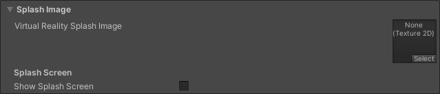
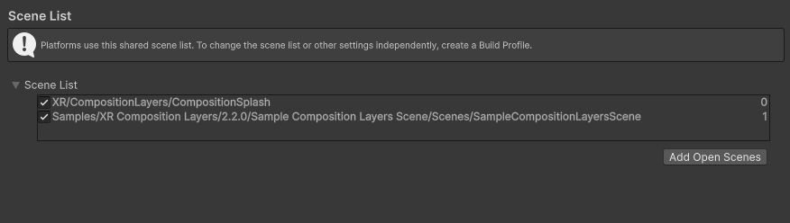

# Composition Layer Splash Screen
Composition Layers supports replacing the default Unity splash screen with a custom splash screen that is rendered using Composition Layers. Using Composition Layers for the Splash screen has some useful benefits, such as improved clarity and sharpness, and much more control over the splash screen appearance (e.g., using a Cylinder Layer, Locking to the horizon, etc.).

To use the Splash Screen provided by Composition Layers, you must disable the default Unity Splash Screen in the Player Settings. This can be done by navigating to `Edit > Project Settings > Player > Splash Image` and unchecking the `Show Unity Splash Screen` and setting `Virtual Reality Splash Image` to `None`.

> [!IMPORTANT]
> When enabling the Composition Layer Splash Screen, a new scene named "CompositionSplash" will automatically be created at *XR/CompositionLayers* and added to the build settings. This scene is used to display the splash screen. If you need to modify the splash screen, you can do so by modifying the settings in the Composition Layer Splash Screen settings or customizing the CompositionSplash scene. This scene will automatically be removed from the build settings when the Composition Layer Splash Screen is disabled.

## Splash Screen Settings
To configure the splash screen, go to **Edit** > **Project Settings** > **XR Plug-in Management** > **Composition Layers**. For a description of each setting, refer to [Composition Layers settings (XR Plug-in Management) reference](xref:xr-layers-project-settings#splash-screen).
