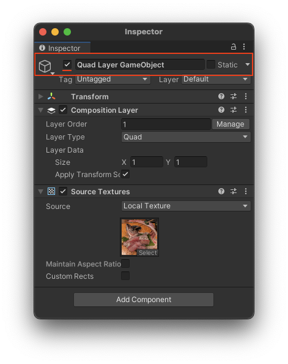

# Enable and disable layers

Enable and disable a composition layer by activating or deactivating its parent GameObject or the Component itself.

## In the Editor

In the Editor, you can enable or disable the parent GameObject in the Inspector by toggling the checkbox next to the GameObject name field.



An inactive GameObject remains in the scene and can be activated [at runtime](#at-runtime).

Refer to [Deactivate GameObjects](xref:DeactivatingGameObjects) in the Unity Manual for general information about managing GameObject state.

Alternately, you can enable or disable the **CompositionLayer** MonoBehaviour on its own by toggling the checkbox next to **CompositionLayer** in the inspector. This leaves the parent GameObject, any child GameObjects, and other components active.

<a id="hide-in-scene-view"></a>
### Hide layers in the Scene view

The **Scene** view always shows composition layers through emulation. Emulated layers can get in the way of scene editing. To hide a layer in the **Scene** view without disabling it, turn off its visibility in the **Hierarchy** window. This doesn't affect the **Game** view or builds. For more information, refer to [Scene visibility](xref:SceneVisibility) in the Unity Manual.

## At runtime

At runtime, use the GameObject [SetActive](xref:UnityEngine.GameObject.SetActive(System.Boolean)) method to control whether a layer is enabled or disabled.

In the following code, `layer` is a reference to a [CompositionLayer](xref:Unity.XR.CompositionLayers.CompositionLayer) component:

``` csharp
// Enable
layer.gameObject.SetActive(true);

// Disable
layer.gameObject.SetActive(false);
```

To enable or disable a **CompositionLayer** MonoBehaviour without changing the state of its parent GameObject, set the `enabled` property:

``` csharp
// Enable
layer.enabled = true;

// Disable
layer.enabled = false;
```

> [!NOTE]
> The state of the parent GameObject takes precedence over the state of any MonoBehaviours. When you set a GameObject to inactive, a MonoBehaviour of that GameObject won't receive updates even if its own state is enabled.

<a id="keep-layers-out-of-builds-without-xr"></a>
## Keep layers out of builds without XR

In a player with no XR display running, such as the desktop version of a project that also ships on an XR device, composition layers can render through emulation. To keep composition layers out of these builds, deactivate their GameObjects, as you would other content that only belongs on XR platforms. Use one of the following approaches:

* Build without XR from a scene or prefab that doesn't contain the composition layers.
* Deactivate the composition layers at runtime when no XR display is running.

The following script deactivates its GameObject and that GameObject's children when no XR display is running at startup. Add it to the parent GameObject of your XR-only composition layers:

[!code-cs[DeactivateWithoutXRDisplay](../Tests/Runtime/CodeSamples/DeactivateWithoutXRDisplay.cs)]

The script checks once, in `Start`. If your project starts XR later than scene load, run the check after XR starts.

## Additional resources

* [Layer emulation at runtime](xref:xr-layers-runtime-settings)
