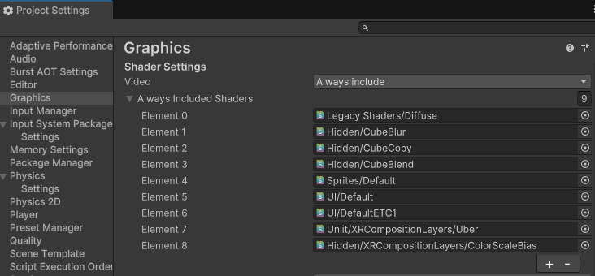
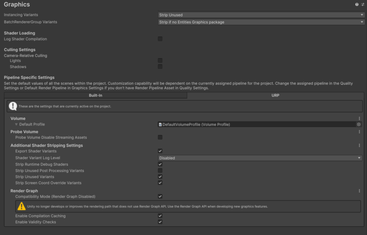

# Configure graphics settings

Configure graphics settings to ensure that the composition layers display correctly in the Unity Editor and at runtime.

Depending on your project's render pipeline, Unity configures some graphics settings automatically, while others require manual setup:

* XR Composition Layers Emulation relies on a specific shader that you must add to the [Always Include Shaders list](#always-include-shaders-list) for the project.
* If the project uses the Universal Render Pipeline (URP), the [Emulation Layer Renderer Feature](#emulation-layer-renderer-feature) is automatically added.
* If the project uses the High Definition Render Pipeline (HDRP), the [Emulation Layer Custom Pass](#emulation-layer-custom-pass) is automatically added to the global `CustomPassVolume`.

The following sections provide more detail on these settings.

## Always Include Shaders list

For composition layer emulation, when Unity detects a standalone **Win, Mac, Linux** build, the `Unlit/XRCompositionLayers/Uber` and `Hidden/XRCompositionLayers/ColorScaleBias` shaders are automatically added to the always include shaders list.

 *The __Always Included Shaders__ list with the Uber and ColorScaleBias shaders added*.

> [!TIP]
> Ensure you enable the **Emulation in Standalone** setting as outlined in [Enable layer emulation in a standalone build](xref:xr-layers-runtime-settings).

## Emulation Layer Renderer Feature (URP)

To support layer emulation in projects using the Universal Render Pipeline (URP), the `EmulationLayerUniversalScriptableRendererPass` (ScriptableRendererPass) is automatically added with `ScriptableRenderer.EnqueuePass()`.

To support Color Scale and Bias emulation in projects using the Universal Render Pipeline (URP), the `EmulationColorScaleBiasPass` (ScriptableRendererPass) is automatically added with `ScriptableRenderer.EnqueuePass()` when the **Color Scale and Bias** component is added to the Default Layer.

### Enable compatibility mode for Underlays

> [!NOTE]
> If your project uses Underlays with URP in Unity versions 6.0 to 6.3, you must enable Compatibility Mode (Render Graph Disable) to render emulated underlay layers. In Unity 6.4 or later, you don't need to enable Compatibility Mode, as Unity removed URP Compatibility Mode.

To select **Compatibility Mode (Render Graph Disable)** in Unity 6.2 and earlier:

1. Open the **Project Settings** window (menu: **Edit > Project Settings**).
1. Select the **Graphics** section.
1. Click on the **URP** tab.
1. Under the Render Graph section enable **Compatibility Mode (Render Graph Disable)**.

 

In Unity 6.3, **Compatibility Mode (Render Graph Disable)** doesn't appear in the Graphics Settings. To enable Compatibility Mode in Unity 6.3, add the `URP_COMPATIBILITY_MODE` scripting define symbol (**Project Settings** > **Player** > **Other Settings** > **Scripting Define Symbols**).

## Emulation Layer Custom Pass (HDRP)

To support layer emulation in projects using the High Definition Render Pipeline (HDRP), the `EmulationLayerHighDefinitionOverlayCustomPass` and `EmulationLayerHighDefinitionUnderlayCustomPass` are automatically added to the global `CustomPassVolume`.

The GameObject which has CustomPassVolume is hidden in hierarchy.

## Additional resources

* [Enable layer emulation in a standalone build](xref:xr-layers-runtime-settings)
