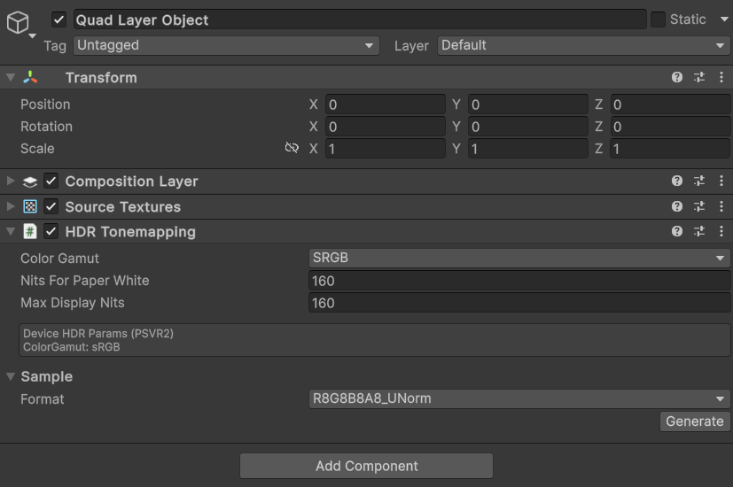
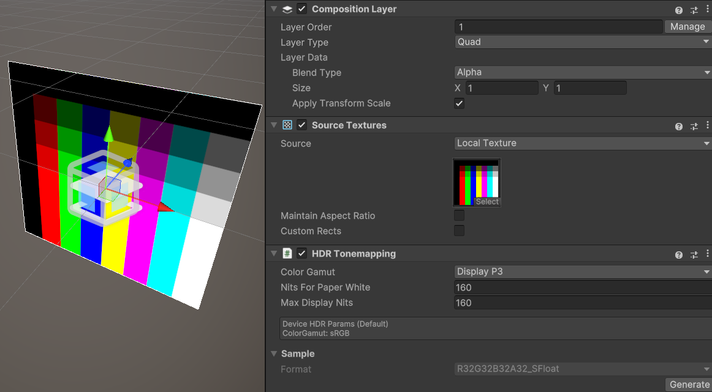
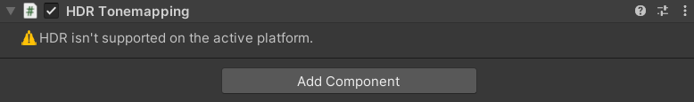

# HDR Tonemapping component

Add an **HDR Tonemapping** extension component to a layer whose source texture is HDR-encoded. The component describes how the texture is encoded, so that XR plug-ins with HDR output can convert the layer's content for the display. To add a component to a layer, refer to [Add or remove a composition layer].

## Requirements

* The PlayStation®VR2 XR plug-in supports this component. The OpenXR plug-in ignores it, so it has no effect on OpenXR devices.
* Only use this component with HDR-encoded textures, including render textures. The component stays active whatever the texture format, so disable it when you don't need it.
* You don't need this component for linear textures. Without it, a texture is treated as a linear texture with an appropriate **Nits For Paper White**. For example, SDR textures are treated as Rec709 with a **Nits For Paper White** of 80 (100 on Metal).

## Component reference

 *The HDR tonemapping component Inspector*

| Property:| Function: |
|:---|:---|
| Color Gamut | The color gamut the source texture is encoded with.|
| Nits For Paper White|The luminance of a white paper surface in the source texture, in nits (candela per square meter, cd/m2).|
| Max Display Nits|The maximum luminance of the source texture, in nits.|
| Format (Sample)| The texture format of the generated sample image. |
| Generate (Sample)| Select **Generate** to create a sample HDR-encoded image and assign it to the **Source Textures** component.|

#### Color Gamut

For correct HDR rendering, set the color gamut the source texture uses. The supported color gamuts are sRGB, Rec709, Rec2020, DisplayP3, HDR10, DolbyHDR, and P3D65G22. For linear textures, set Rec709 and an appropriate **Nits For Paper White**.

#### Sample image generator

The component can generate sample HDR images to help you test which HDR formats a platform supports.
To create a sample HDR texture, choose a texture format in the **Sample** section of the component Inspector and select **Generate**.
The sample texture replaces the layer's source texture. Your original texture asset isn't changed or deleted. The sample texture isn't saved as an asset, and is stored in the scene.

 *The sample texture image with Sample image generator.*

#### Limitation

The component needs an XR plug-in that supports HDR output, installed through **XR Plug-in Management**.
Where the active XR plug-in doesn't support HDR, the component is disabled and its settings are hidden in the Inspector.

 *The HDR tonemapping component Inspector in environments where HDR is unsupported.*

[Add or remove a composition layer]: xref:xr-layers-add-layer
