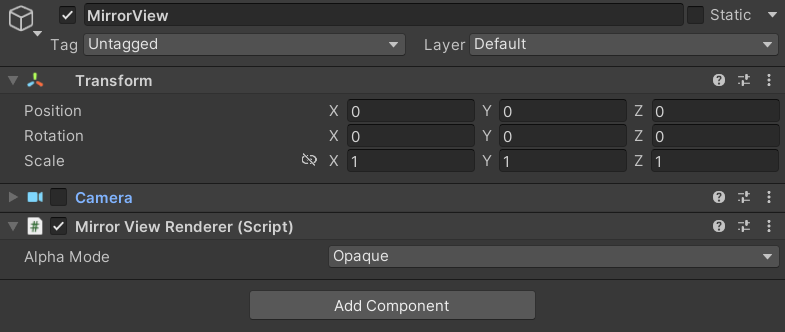

# Mirror View Renderer

Render composition layers to the Main Display when running in XR mode.

The `MirrorViewRenderer` supports mirror view rendering for Main Display on XR mode. It includes all composition layer drawings.

> [!TIP]
> This component isn't required if mirror view rendering with all composition layers is already implemented on the XR plug-in side.

 *The Mirror View Renderer Component Inspector*

| Property:| Function: |
|:---|:---|
| Alpha Mode| Set how draw the eye texture. (**Opaque, Alpha and Premultiply**) |

## Background

In some case, the mirror view rendering with composition layers isn't supported by default.
- Some XR Plug-ins

Unity provides this function to assist them. The Mirror View Renderer requires the Universal Render Pipeline (URP). High Definition Render Pipeline (HDRP) support has been deprecated and will be removed in a future release.

## Supplement

The MirrorViewRenderer uses the `Unlit/XRCompositionLayers/Uber` and `Unlit/XRCompositionLayers/BlitCopyHDR` shaders. XR Composition Layers includes them in builds automatically. For more information, refer to [Shader inclusion](xref:xr-layers-graphics-settings#shader-inclusion).
