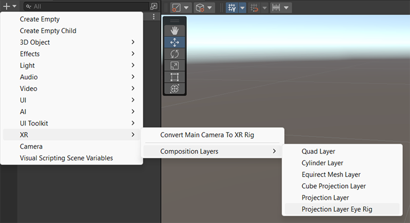
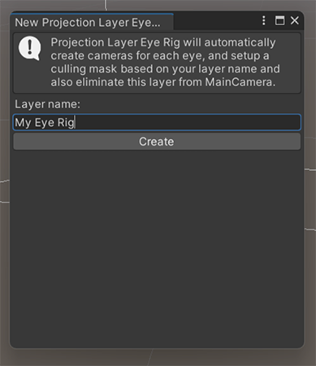
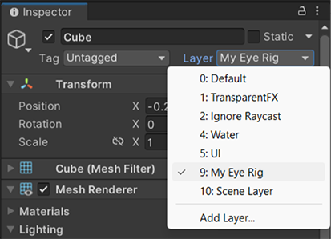

# Projection Eye Rig

The **Projection Eye Rig** a special projection layer prefab that allows you to render scene objects on a different projection layer than the Default Scene Layer.

> [!IMPORTANT]
> Ensure that **Run Without Focus** is enabled in the Player Settings. Otherwise, when the application loses focus, objects shown in the Projection Eye Rig layer will not update correctly and will appear locked to the user's head. You can find the **Run Without Focus** setting in the **Resolution and Presentation** section of your project's Player settings and Build Profiles. The setting is available for the Android, Android XR, and Meta Quest platforms.

## Create a Projection Eye Rig

You can create a Projection Eye Rig in the same way you would create a composition layer, via the add GameObject dropdown menu.

<br />*The CompositionLayer Dropdown Menu*

At this point you will be prompted to enter a layer name for the eye rig.

<br />*Projection Eye Rig Name Prompt*

The layer name you enter is used to name the eye rig, and also assigned to an unused Unity Layer. This Unity layer is in the culling layer mask to determine which GameObjects in the scene are rendered to the Projection Eye Rig and which are rendered to the default scene layer.

## Assign GameObjects to the Projection Eye Rig

To assign scene GameObjects to render to the Projection Eye Rig, go to the Inspector of the object and assign its **Layer** to the Unity Layer with the same name as the Projection Eye Rig.

<br />*Assign object to eye rig*

This action will cull the object from the main camera, and add it to the hidden camera(s) of the Projection Eye Rig, thereby rendering it on a different Projection Layer.

## Emulation of the Projection Eye Rig

Unlike the standard Projection Layer where you can manually assign textures to the layer, the Project layer eye rig will not allow for texture assignment. Instead it will generate its own textures from a number of cameras that mimic the active cameras during edit time, play mode, and runtime.

In edit time, the eye rig will follow the Scene Camera. During Play Mode, it will follow the Main Camera, and at runtime it will render from the two eye cameras.

## Projection Eye Rig cameras

When you create a Projection Eye Rig, Unity adds two child GameObjects, **Left Camera** and **Right Camera**, and the rig keeps a reference to each. You can rename these GameObjects. Keep them as the rig's first two children, because platforms that composite the rig natively find the cameras by their order. Don't delete them, because the rig can't render without both cameras.

A Projection Eye Rig created with an earlier version of the package uses its first two child GameObjects, if both have a Camera component.

## Change a Projection Eye Rig to another layer type

In the **Inspector** window, the Composition Layer component's **Layer Type** dropdown is unavailable for a Projection Eye Rig. To change the type from a script, call `CompositionLayer.ChangeLayerDataType`.

In the Editor, changing a Projection Eye Rig to another layer type does the following:

- Removes the **Left Camera** and **Right Camera** GameObjects.
- Shows the Source Textures component and clears its textures.
- Sets the GameObject's **Layer** to **Default**.

To restore the rig, select **Edit** > **Undo**. The Unity Layer created for the rig stays in the project, and the Main Camera's culling mask still excludes it.

## Fix a Projection Eye Rig with missing cameras

If a Projection Eye Rig is missing its **Left Camera** or **Right Camera**, the **Inspector** and **Hierarchy** windows display a warning, and each time emulation starts, Unity logs an error that begins with the rig's name, followed by this message:

```
This Projection Eye Rig is missing its Left Camera or Right Camera, so it cannot render. Delete it and create a new one from GameObject > XR > Composition Layers > Projection Eye Rig.
```

To fix the rig, delete it and create a new Projection Eye Rig from **GameObject** > **XR** > **Composition Layers** > **Projection Eye Rig**. Then assign your GameObjects to the new rig's Unity Layer as described in [Assign GameObjects to the Projection Eye Rig](#assign-gameobjects-to-the-projection-eye-rig).
