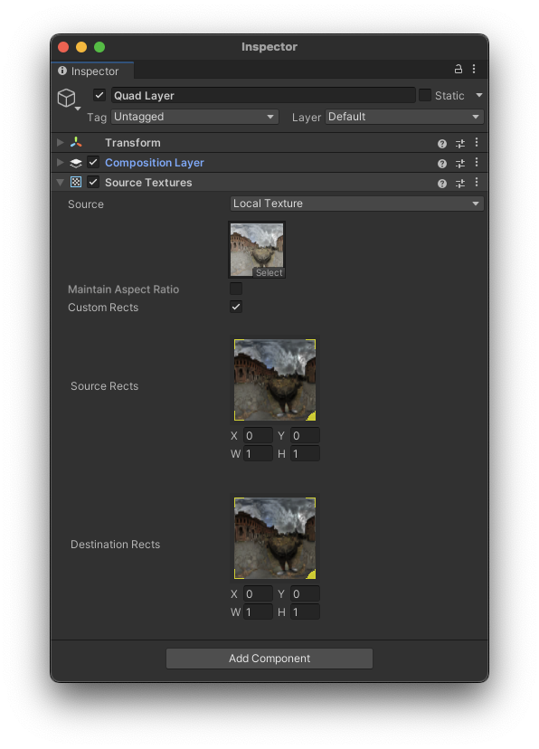
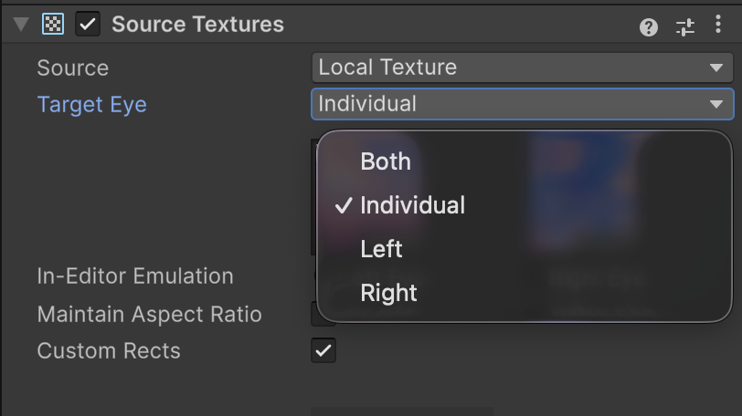
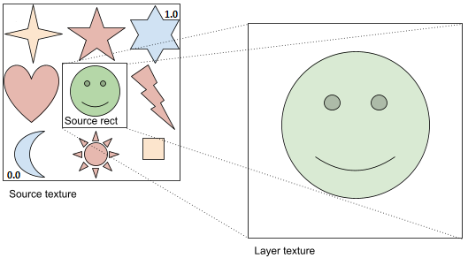
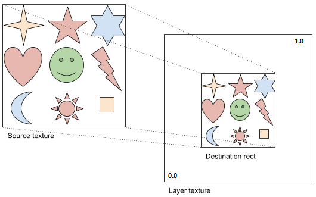
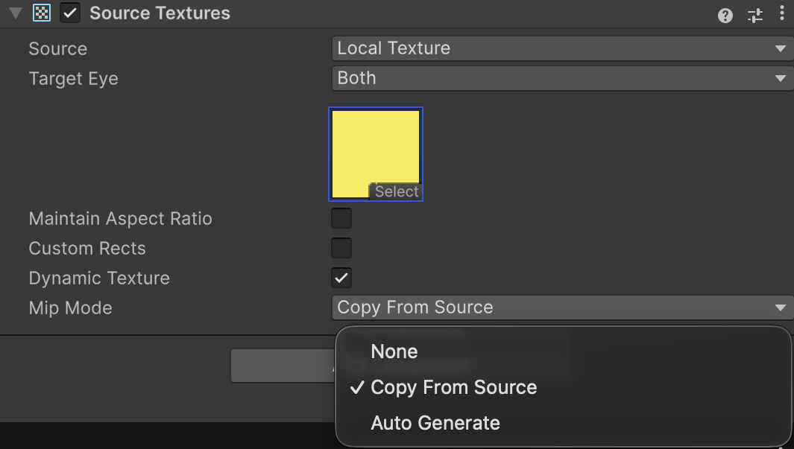

# Source Textures component

Add a Source Textures extension component to specify textures to render to a layer, as outlined in [Add or remove a composition layer](xref:xr-layers-add-layer). On Android, for Quad and Cylinder layer types, you can also specify an [Android Surface](#android-surface) as the source texture.

## Source Textures component reference

The following options are available in the Source Textures extension component **Inspector**:

| Property:| Function: |
|:---|:---|
| Source | Specify the source of the texture - Local Texture or Android Surface. |
| Target Eye | Controls which eye(s) see the layer, and whether separate textures are used per eye. Refer to [Target Eye options](#target-eye-options) for more information. |
| Texture (Local Texture Only)| Specify a texture to use. Click Select to choose a texture or drag-and-drop a texture onto the control with your mouse. |
| Resolution (Android Surface Only)| Specify the resolution for the Android Surface with X for width, and Y for height. |
| Maintain Aspect Ratio (Quad/Cylinder Layer/Android Surface Only)| Crop the layer to fit the aspect ratio of the texture. |
| In-Editor Emulation | Specify whether the left or right eye texture is shown in the Unity Editor. Shown for Projection layers and layers when you set **Target Eye** mode to **Individual**. |
| Custom Rects| Enable to specify custom rects within the source and destination textures. |
| Dynamic Texture (Local Texture Only)| Enable to update the layer every frame, for source textures whose contents are updated outside of Unity's render pipeline. Refer to [Dynamic textures](#dynamic-textures) for more information. |
| Mip Mode (Local Texture Only)| Controls whether the layer uses mipmaps and how the mip levels are filled. Shown only when the assigned texture has a mip chain. For more information, refer to [Mip Mode](#mip-mode). |
| Source Rects1| Specifies a rectangle within the source texture to copy to the destination rather than copying the entire texture. Use your mouse to set the rect values or enter them into the x, y, w, and h fields. |
| Destination Rects1| Specifies a target rectangle within the destination texture to which to write the source texture rather than filling the entire destination texture. Use your mouse to set the rect values or enter them into the x, y, w, and h fields. |

1 Custom source rects and custom destination rects are not supported by composition layers of cube projection or equirect types.

 *The Source Textures component Inspector*

> [!NOTE]
> Different types of composition layers support different texture settings. Only the settings supported by the current type of layer are shown in the Inspector.

## Target Eye options

The **Target Eye** setting controls which eye(s) a composition layer is visible to, and whether separate textures can be assigned per eye. **Target Eye** is available for the standard Quad, Cylinder, Equirect, and Cube layer types. Projection layers always use stereo rendering.

| Option | Description |
|:---|:---|
| Both | The layer is visible to both eyes with a single shared texture. This is the default. |
| Individual | Allows you to assign separate textures for the left and right eyes. When you select this option, the **Inspector** shows two texture slots. Use the **In-Editor Emulation** toggle to preview each eye's texture. Choose **Individual** for content that should appear different in each eye. |
| Left | The layer is visible only to the left eye. |
| Right | The layer is visible only to the right eye. |

 *The Target Eye dropdown*

> [!NOTE]
> The Target Eye setting is not available for UI layers (layers with an **Interactable UI Mirror** component), or Android Surface Layers. Android Surface and UI layers always render to both eyes.

> [!NOTE]
> When you choose **Individual** in the **Target Eye** mode, each layer counts as two composition layers at runtime. Keep this in mind when managing the total number of active layers, as XR runtimes have a maximum layer count.

## Custom source rects

You can use a custom source rect to define a rectangle subset of the source texture to use. The upper left of the source texture is coordinate (0,0) and the lower right is coordinate (1,1). Likewise, the full width and height are normalized to (1,1).

 *A source rect of approximately (.3, .3, .3, .3)*

## Custom destination rects

You can use a custom destination rect to define where to place the texture within a composition layer. The upper left of the layer is coordinate (0,0) and the lower right is coordinate (1,1). Likewise, the full width and height are normalized to (1,1).

 *A destination rect of approximately (.25,.25,.5,.5)*

## Dynamic textures

Enable **Dynamic Texture** when the contents of your source texture are updated outside of Unity's render pipeline, such as a `Texture2D` that wraps a native plugin texture or an Android `AHardwareBuffer`. Without this setting, the layer displays the first frame of such a texture for the rest of the session.

A provider implementation copies the source texture to the layer when it detects that the texture changed. A [Render Texture](xref:UnityEngine.RenderTexture), such as one written to by a Video Player or a Camera, triggers this detection automatically, but a texture written by external code does not. When you enable **Dynamic Texture**, the layer is always treated as changed, so the provider copies the texture every frame.

Leave **Dynamic Texture** disabled for Render Textures, which already update every frame, and for textures whose contents never change. In both cases the layer displays the same result either way, and the extra copy each frame costs performance.

> [!NOTE]
> **Dynamic Texture** is only available when you set **Source** to **Local Texture**. As with other layer extension properties, a provider implementation for a device might not support this setting.
## Mip Mode

**Mip Mode** controls whether a layer uses mipmaps and how its mip levels are filled. Mipmaps reduce shimmering and aliasing when a layer is viewed at a distance or at a shallow angle. Mipmaps come at the cost of extra swapchain memory, so they are opt-in.

### Mip Mode requirements

Mip Mode has the following requirements:

* Applies to **Local Texture** sources only.
* Requires the OpenXR Plugin package (1.19.0-pre.2 or newer) and Unity 6000.7.0a4 or newer.
* Supported on Quad, Cylinder, Cube, and Equirect layers.

> [!NOTE]
> Projection layers and Android Surface sources don't use mipmaps.

### Configure Mip Mode

The **Mip Mode** dropdown appears only when the assigned texture already has a mip chain. For imported textures, enable **Generate Mip Maps** in the texture's import settings.

The following options are available in the **Mip Mode** dropdown:

| Option | Description |
|:---|:---|
| **None** | No mipmaps so the layer's swapchain is single-mip. This is the default. |
| **Copy From Source** | Copies every authored mip level from the source texture into the layer. Use this when your texture has hand-authored or pre-filtered mips. The source format must be directly copyable to the layer. |
| **Auto Generate** | Copies the base mip level, then generates the smaller mip levels automatically. Use this when the source can't be copied directly, such as a compressed or different-format texture. |

 *The Mip Mode dropdown*

> [!NOTE]
> OpenGL ES doesn't support copied mipmaps. On OpenGL ES, **Copy From Source** always falls back to **Auto Generate**.

### Change Mip Mode at runtime

You can change **Mip Mode** at runtime. Switching to or from **None** recreates the layer's swapchain because the mip count changes. Switching between **Copy From Source** and **Auto Generate** only changes how each frame is written.

## Android Surface

When developing for Android, you can use Android Surfaces for efficiently rendering graphics or displaying content such as hardware decoded video. Refer to [Display Android Surface Content](xref:xr-layers-android-surface) for more information.

## Additional resources

* [Add or remove a composition layer](xref:xr-layers-add-layer)
* [Introduction to texture Mipmaps](https://docs.unity3d.com/Manual/texture-mipmaps-introduction.html) (Unity Manual)
* [Configure graphics settings](xref:xr-layers-graphics-settings)
